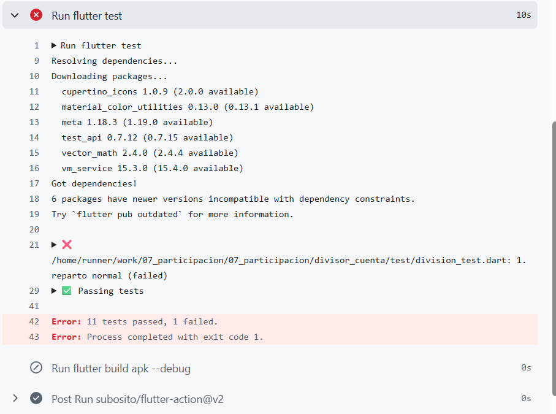
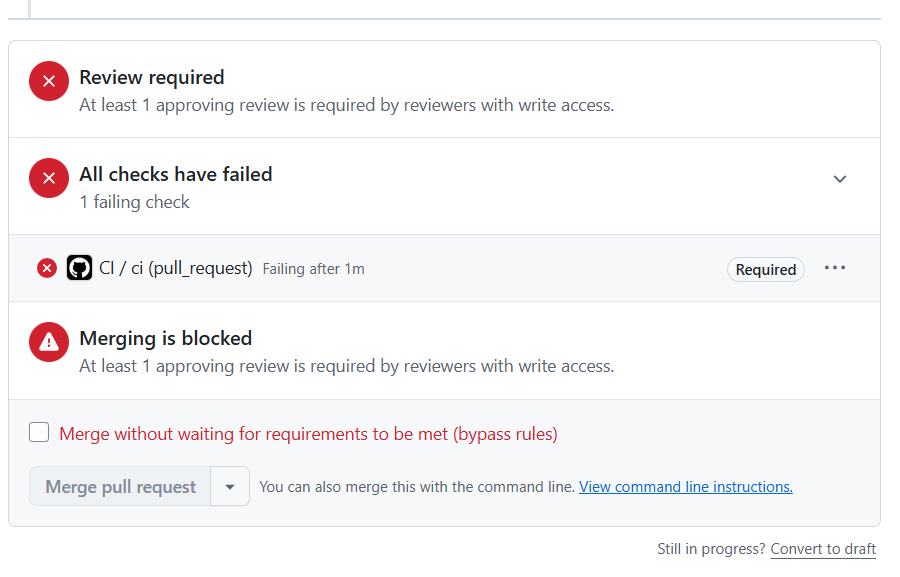

# Respuestas — Deber 3

1. **Rojo antes de verde.** La prueba esperaba que la validación lanzara `FormatException` con el mensaje `La propina no puede superar el 100%`, pero en la versión sin la regla devolvió una `Cuenta`. Verla fallar confirma que la prueba detecta el comportamiento que se quería agregar.

2. **Linter vs. IA.** Al agregar temporalmente los ejemplos, `flutter analyze` reportó `unused_local_variable` para una variable sin uso y `avoid_print` para `print('hola')`. El code smell elegido fue que `build` concentraba demasiado código de interfaz. El linter no lo señaló porque esa complejidad es válida sintácticamente y requiere valorar la estructura y legibilidad del código.

3. **Refactorización.** Se extrajeron del método `build` los bloques del encabezado, formulario y resultado a `_construirEncabezado`, `_construirFormulario` y `_construirResultado`. Las pruebas de dominio y de pantalla siguen pasando, lo que comprueba los comportamientos que cubren sin cambiar sus resultados.

4. **Coverage.** `lib/main.dart` tuvo el porcentaje menor: **47,06 %** de líneas. Eso no significa que tenga errores; coverage indica qué líneas ejecutaron las pruebas, no si el código es correcto.

---

# Respuestas — Deber 4

1. **Workflow actual:**

   ```yaml
   name: CI

   on:
     push:
       branches:
         - main
     pull_request:

   jobs:
     ci:
       runs-on: ubuntu-latest
       defaults:
         run:
           working-directory: divisor_cuenta
       steps:
         - uses: actions/checkout@v4
         - uses: actions/setup-java@v4
           with:
             distribution: temurin
             java-version: '17'
         - uses: subosito/flutter-action@v2
           with:
             channel: stable
         - run: flutter pub get
         - run: flutter analyze
         - run: flutter test
         - run: flutter build apk --debug

     entrega:
       needs: ci
       if: github.event_name == 'push' && github.ref == 'refs/heads/main'
       runs-on: ubuntu-latest
       defaults:
         run:
           working-directory: divisor_cuenta
       steps:
         - uses: actions/checkout@v4
         - uses: actions/setup-java@v4
           with:
             distribution: temurin
             java-version: '17'
         - uses: subosito/flutter-action@v2
           with:
             channel: stable
         - run: flutter pub get
         - run: flutter build apk --debug
         - uses: actions/upload-artifact@v4
           with:
             name: app-debug-apk
             path: divisor_cuenta/build/app/outputs/flutter-apk/app-debug.apk
   ```

   - `analyze`: busca problemas estáticos y de estilo en el código Dart.
   - `test`: ejecuta las pruebas automatizadas.
   - `build`: compila el APK de depuración para comprobar que la app construye.

2. La línea del test identifica `1. reparto normal (failed)`; el resumen dice `Error: 11 tests passed, 1 failed.` La prueba falló al comparar el esperado modificado (`27.00`) con el resultado correcto (`27.50`).

   

3. **CI** integra cambios y los verifica automáticamente; **continuous delivery** deja una versión lista para publicar, normalmente con aprobación manual; **continuous deployment** publica automáticamente en producción. Implementé CI y entrega continua del APK como artifact en `main`, sin desplegarlo a producción.

4. La protección evita fusionar cambios mientras falle el check requerido o falte la aprobación configurada, reduciendo el riesgo de romper `main`.

   

5. El agente recomendó fijar las acciones de terceros a SHA completos verificados y declarar permisos mínimos para `GITHUB_TOKEN` (por ejemplo, `contents: read`). Acepté documentar esas mejoras, pero no las apliqué en esta revisión: primero hay que verificar los SHA. No sugirió añadir dependencias.

6. Un CI verde confirma que los pasos configurados pasaron en ese commit y entorno; no demuestra que todos los casos o dispositivos funcionen. Puede quedar sin detectar un error en una pantalla no cubierta por pruebas; por ejemplo, un texto incorrecto si las pruebas solo validan los cálculos.

7. El pipeline detectó que el resultado esperado del reparto normal ya no coincidía con el cálculo: la prueba falló cuando se cambió intencionalmente de `27.50` a `27.00`.
